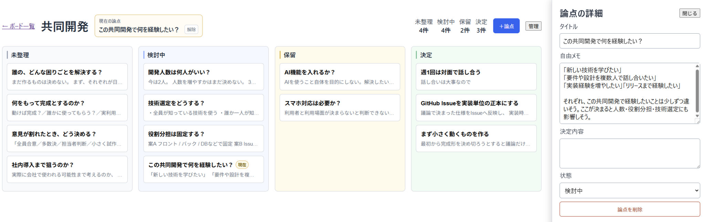

# Waypoint

Waypoint は、話し合いの「現在地」を可視化するためのシンプルな議論整理ツールです。

[](./docs/images/waypoint-board-overview.png)

## 目的

通常のメモや議事録では埋もれやすい、

- まだ整理できていないこと
- 現在検討していること
- いったん保留していること
- すでに決まったこと

をカードとして整理し、**何が決まり、何が宙ぶらりんなのかを一目で確認できる状態**を作ることを目的とします。

## 初期の利用イメージ

3〜4人程度の小規模な話し合いで、一人が議事録のように論点をカード化し、全員で同じボードを見ながら現在地を共有します。

1枚のカードは1つの論点を表し、まずは以下の4状態で管理します。

- 未整理
- 検討中
- 保留
- 決定

## MVPの方針

最初は、会話中でも負担なく使えるシンプルさを優先します。

要件定義全般、タスク管理、複雑な権限管理などを最初から扱うのではなく、**論点とその状態を分かりやすく残し、あとからすぐ見返せること**に集中します。

共同編集やAIによる議論整理などの追加機能は、実際に使ったうえで必要性を判断します。

## 必要環境

- Node.js
- npm

## セットアップ

リポジトリ直下で実行します。

```bash
npm install
```

## 起動

```bash
npm run dev
```

Viteがターミナルに表示するLocal URLをブラウザで開いてください。通常は `http://localhost:5173/` ですが、ポートの使用状況によって変わるため、表示されたURLを正本とします。

## 基本的な使い方

1. 「＋新しいボード」で話し合い用のBoardを作成します。
2. 「＋論点」でカードを追加します。
3. カードをクリックし、自由メモと決定内容を編集します。
4. 未整理 / 検討中 / 保留 / 決定の4列で状態を整理します。
5. ドラッグ&ドロップで状態変更や並び替えを行います。
6. 一覧へ戻り、保存済みのBoardを再開します。

## データ保存

MVPでは、データをブラウザのLocalStorageへ保存します。バックエンド、DB、クラウド同期は使用していません。同じ端末・同じブラウザでの利用を基本とし、ブラウザのサイトデータを削除するとBoardも失われる可能性があります。

## JSONバックアップ

Boardの管理メニューから「JSONエクスポート」でバックアップできます。ボード一覧の「インポート」から復元でき、インポートしたBoardは元のBoardとは別のBoardとして追加されます。

## レポートの共有

ボードの「管理」メニューから、議論状況を以下の形式で持ち出せます。

- **Markdownをコピー／保存**：検討中・保留・未整理を先に示し、決定事項も含めます。チャットやIssueへの共有に使えます。
- **HTMLレポートを保存**：状態ごとの件数とカードをWaypointの状態色で表示する、単体で閲覧できるHTMLファイルです。
- **印刷／PDFとして保存**：印刷用に整えたHTMLレポートを別画面で開きます。ブラウザの印刷先で「PDFに保存」を選んでください。印刷画面を開けない場合は、保存したHTMLファイルをブラウザで開いて印刷できます。

これらは出力時点のスナップショットであり、会議の日時・参加者・承認を記録した議事録ではありません。決定欄に文字があっても、状態が「決定」以外なら未確定として表示します。JSONエクスポート／インポートは従来どおりバックアップ／復元専用です。

## テスト

```bash
npm test
```

## ビルド

```bash
npm run build
```

## MVPの利用想定

3〜4人程度の小規模な話し合いで、1人が操作し、全員で同じ画面を見ながら論点の現在地を共有する利用形態を想定しています。

## ライセンス

MIT License で公開しています。詳細は [LICENSE](./LICENSE) を参照してください。
